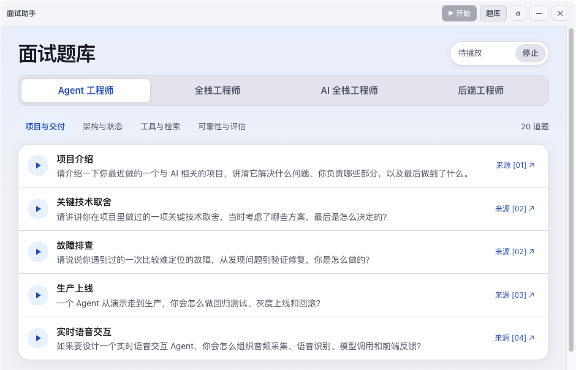
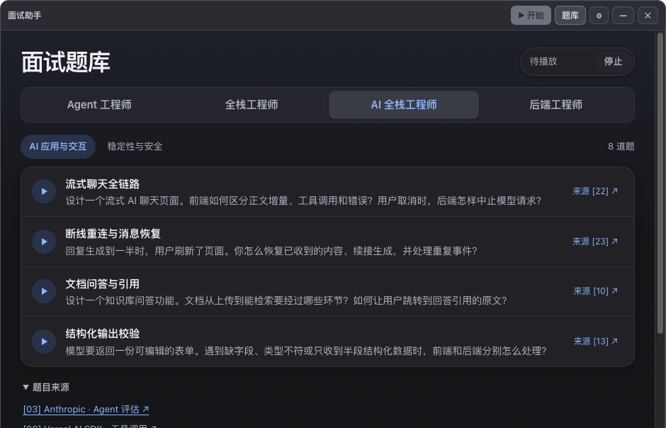

  

<h1 align="center">面试助手 · Interview Assistant</h1>

  
  
  
  

  <a href="#下载安装">下载安装</a> · <a href="#页面预览">页面预览</a> · <a href="#功能">功能</a> · <a href="#快速开始">快速开始</a> · <a href="#验证与许可">验证与许可</a>

面试助手是一款适用于 Windows 和 macOS 的桌面应用，支持面试练习、会议转写和 AI 回答。点顶部「题库」即可切换职位、朗读题目和查看出处。

## 下载安装

| 系统 | 安装包 | 安装方法 |
| --- | --- | --- |
| **Windows 10 / 11（x64）** | [下载 .exe](https://github.com/wyf027/interview-assistant-downloads/releases/download/v0.2.0-beta.2-question-bank/InterviewAssistant-0.2.0-beta.2-win-x64-setup.exe) | 双击安装，再从「开始」菜单打开 |
| **macOS 12 或更新版本（Apple 芯片）** | [下载 .dmg](https://github.com/wyf027/interview-assistant-downloads/releases/download/v0.2.0-beta.2-question-bank/InterviewAssistant-0.2.0-beta.2-mac-arm64.dmg) | 打开镜像，将「面试助手」拖到「应用程序」 |

[发布说明与 SHA-256 校验文件](https://github.com/wyf027/interview-assistant-downloads/releases/tag/v0.2.0-beta.2-question-bank)

Windows 安装包未进行数字签名，macOS 安装包未经过 Apple 公证。Mac 首次启动如被系统拦截，可查看 [Apple 官方说明](https://support.apple.com/zh-cn/102445)。

## 页面预览

<table>
  <tr>
    <th>职位切换与题目朗读</th>
    <th>深色模式与题目来源</th>
  </tr>
  <tr>
    <td></td>
    <td></td>
  </tr>
</table>

## 功能

| 功能 | 支持内容 |
| --- | --- |
| **面试题库** | 44 道题，覆盖 Agent、全栈、AI 全栈和后端工程师，支持按主题筛选 |
| **朗读与溯源** | 点击题目朗读，点击来源编号在浏览器查看原文 |
| **实时转写** | 分别显示自己和对方的语音转写，可按系统配置两路音频 |
| **AI 回答** | 手动提问或开启「持续答」，可导入简历和岗位描述作为回答背景 |
| **截图问答** | 可手动框选，也可在手动提问涉及当前屏幕时截图，并在回复中显示截图 |

## 快速开始

### 1. 打开题库练习

首次打开时，选择「开始配置」→「高级配置与本地模式」。进入主窗口后点「题库」，按职位和主题选题。练题无需 API Key。

### 2. 配置转写和回答

在「设置」中选择转写后端和 AI 服务。使用云服务时，填写自己的 API Key。Windows 支持采集系统播放音频。macOS 可在安装 BlackHole 等虚拟音频设备后，将它选为「对方音频输入」。设置好后，点击顶部的「开始」。

### 3. 使用截图问答

在输入框询问当前屏幕内容，或用截图按钮手动框选。macOS 首次截图时，按系统提示授权「屏幕与系统音频录制」。截图问答需要配置支持图片的模型。

## 验证与许可

- macOS 已验证安装包挂载、首次启动、进入题库和朗读。
- Windows 已验证下载校验、安装、启动与题库访问。[Windows 验证记录](https://github.com/wyf027/interview-assistant-downloads/actions/runs/45939442336)
- 本版本基于 [JWM0203/MeetingCopilot](https://github.com/JWM0203/MeetingCopilot)，按 Apache 2.0 许可证分发，许可证及修改说明随安装包提供。
